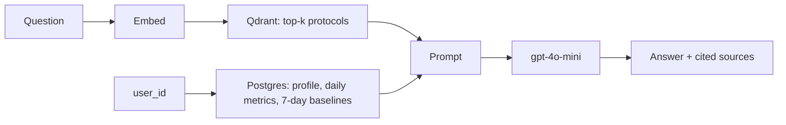

# Fitness RAG Coach

An AI fitness coach that turns your daily HRV, sleep and resting heart rate into concrete training
advice, grounded in vetted recovery and nutrition protocols and citing every source it uses.

**Stack:** Python, FastAPI, PostgreSQL (SQLAlchemy, Alembic), Qdrant, OpenAI (`text-embedding-3-small`,
`gpt-4o-mini`), Streamlit, Docker, Caddy.

<!-- Add a screenshot of the chat answering a question: docs/screenshot.png
 -->

## What it does

- **Personal context:** compares today's metrics with your rolling 7-day baseline, computed in SQL
  with window functions, and puts the exact numbers in the prompt.
- **Grounded answers:** retrieves the most relevant protocols from a vector database and instructs
  the model to answer only from them, cite them by ID, and flag medical red flags.
- **Wearable and nutrition sync:** connects Fitbit data through the Google Health API (OAuth 2.0) and
  the FatSecret food diary (OAuth 1.0), with encrypted tokens, automatic refresh, retries and idempotent upserts.
- **Measured retrieval:** a labeled question set scores search with hit rate, recall and MRR at k.
- **Production basics:** per-user token auth with object-level access checks, rate limiting on the
  LLM endpoint, upstream timeouts, request IDs in logs (no health data), Docker deployment behind HTTPS.
- **Runs offline:** demo mode and the test suite need no API key.

## How it works



## Design decisions

- **Two stores for two kinds of data.** Protocols are unstructured text, searched by meaning in Qdrant.
  Biometrics are exact numbers, queried in Postgres. Similarity search would blur the numbers.
- **RAG instead of fine-tuning.** Metrics change daily and advice must trace back to a source.
  Updating knowledge means re-embedding a document, not retraining a model.
- **Idempotent daily upserts.** One row per user per day with a unique constraint, so re-logging or
  a future wearable sync updates the day instead of duplicating it, and only overwrites the fields sent.
- **Evaluation before tuning.** Chunking and top-k stay unchanged until the eval says retrieval is weak.

## Results

Retrieval on 26 labeled questions over 12 protocols (`python -m scripts.eval_retrieval`):

| Embeddings | Hit rate @1 | Hit rate @3 | Recall @3 | MRR |
|---|---|---|---|---|
| OpenAI `text-embedding-3-small` | 0.88 | 1.00 | 0.99 | 0.94 |
| Word-hashing baseline (offline) | 0.38 | 0.81 | 0.78 | 0.57 |

Semantic embeddings find the right protocol for questions that share no keywords with it
(for example "almost passed out at rest" retrieves the medical red-flags protocol).
The knowledge base is small, so these numbers show the method works; they will drop as protocols grow.

## Project layout

| Path | Role |
|---|---|
| `data/protocols.json` | Unstructured knowledge, searched by meaning (vector DB) |
| `data/users.json` | Two demo users, loaded into Postgres by `scripts/seed.py` |
| `app/db/models.py` | SQLAlchemy tables: `users`, `daily_biometrics` (one row per user per day) |
| `app/data_access/users.py` | Profile lookup with rolling 7-day baselines computed in SQL |
| `app/data_access/biometrics.py` | Idempotent per-day upsert of metrics |
| `app/rag/embeddings.py` | Text to vectors (OpenAI embeddings) |
| `app/rag/vector_store.py` | Qdrant collection: recreate, upsert, filtered search |
| `app/rag/prompt.py` | System rules, computed baselines, retrieved protocols |
| `app/rag/generator.py` | Chat completion call |
| `app/rag/demo.py` | Offline stand-ins for OpenAI (demo mode and tests) |
| `app/main.py` | FastAPI app: `POST /ask`, `/users` endpoints |
| `app/integrations/` | Google Health and FatSecret clients, OAuth flows, token encryption, sync |
| `ui/streamlit_app.py` | Chat UI with metrics and charts; calls the API over HTTP |
| `migrations/` | Alembic schema migrations |
| `scripts/ingest.py` | Embed protocols and load them into Qdrant |
| `scripts/cosine_playground.py` | Brute-force cosine search in NumPy |

## Run locally

One-time setup:

```bash
python -m venv .venv && source .venv/bin/activate
pip install -r requirements.txt
cp .env.example .env                # set OPENAI_API_KEY (or DEMO_MODE=true)
docker compose up -d                # Postgres on :5432, Qdrant on :6333
alembic upgrade head                # create the tables
python -m scripts.seed              # optional: the two demo users
python -m scripts.ingest            # embed protocols into Qdrant (needs the OpenAI key)
```

Every time, in two terminals:

```bash
uvicorn app.main:app --reload       # terminal 1: the API, docs at http://127.0.0.1:8000/docs
streamlit run ui/streamlit_app.py   # terminal 2: the chat UI at http://localhost:8501
```

```bash
curl -X POST localhost:8000/ask -H 'Content-Type: application/json' \
  -d '{"user_id": "u1", "question": "My HRV dropped and my CNS feels fried. How should I adjust leg day?"}'
```

### Demo mode (no OpenAI key)

`DEMO_MODE=true uvicorn app.main:app --reload` skips `scripts.ingest`: protocols are embedded at
startup with a word-hashing stand-in, and the answer shows the prompt that would be sent to GPT.
Postgres still has to be running. Nothing is sent to OpenAI.

## Make it yours

In the UI sidebar, open **New profile** to create yourself, then **Log a day** each morning
(HRV, sleep score, resting HR, calories; any subset). Re-logging a day only overwrites the fields you fill in.
The coach compares your latest day with the previous 7 days, and the UI warns when today is not logged yet.

The same over HTTP:

```bash
curl -X PUT localhost:8000/users/me -H 'Content-Type: application/json' \
  -d '{"name": "Suleyman", "age": 30, "weight_kg": 78.5, "goal": "strength"}'
curl -X PUT localhost:8000/users/me/days/2026-10-10 -H 'Content-Type: application/json' \
  -d '{"hrv_ms": 58, "sleep_score": 71, "resting_hr_bpm": 56}'
```

## Connect your data (Fitbit via Google Health, FatSecret)

Instead of typing numbers, the coach can pull them:

| Provider | Data | Login |
|---|---|---|
| [Google Health API](https://developers.google.com/health) (Fitbit, Pixel Watch) | Daily HRV, daily resting heart rate, minutes asleep in the main sleep | OAuth 2.0 with refresh tokens |
| [FatSecret Platform](https://platform.fatsecret.com) | Total calories per day from your food diary | 3-legged OAuth 1.0 |

Tokens are encrypted at rest with `TOKEN_ENCRYPTION_KEY`. Syncing is idempotent: each provider only
overwrites its own fields, and days with no diary entries are skipped rather than stored as 0 kcal.

**1. Encryption key.** Run `python -m scripts.generate_key` and put the output in `.env` as `TOKEN_ENCRYPTION_KEY`.

**2. Google Health (about 10 minutes).** In the [Google Cloud console](https://console.cloud.google.com):

1. Create a project, then enable the **Google Health API** under APIs & Services, Library.
2. Configure the OAuth consent screen: user type External, app in Testing mode. Under test users, add the
   Google account your Fitbit is linked to. Add the scopes
   `googlehealth.health_metrics_and_measurements.readonly` and `googlehealth.sleep.readonly`.
3. Create an OAuth client of type **Web application** with the authorized redirect URI
   `http://localhost:8000/integrations/google/callback`.
4. Put the client ID and secret in `.env` as `GOOGLE_CLIENT_ID` and `GOOGLE_CLIENT_SECRET`.

If the console looks different, follow Google's [Get started guide](https://developers.google.com/health).
Apps in Testing mode get refresh tokens that expire after 7 days, so expect to press Connect again weekly
until the app is verified; the UI shows "Connect Google Health again" when that happens.

**3. FatSecret.** Register at [platform.fatsecret.com](https://platform.fatsecret.com), copy the OAuth 1.0
**Consumer Key** and **Consumer Secret** into `.env` as `FATSECRET_CONSUMER_KEY` and `FATSECRET_CONSUMER_SECRET`.
FatSecret may require your public IP address in the app's allowed IPs. Reading the food diary may need
FatSecret's Premier tier; if so, sync shows the FatSecret error message instead of calories.

**4. Connect.** Restart the API, open the UI, and in the sidebar open **Connected apps**: press Connect,
approve access on the provider's page, then press **Sync now** (pulls the last 14 days).
To sync on a schedule, run `python -m scripts.sync` from cron; the production stack does it every 3 hours.

## Check retrieval quality

`data/eval_questions.json` lists questions with the protocol IDs they should retrieve.

```bash
python -m scripts.eval_retrieval            # OpenAI embeddings (needs the key)
python -m scripts.eval_retrieval --demo     # offline hashing embedder, for comparison
```

It prints hit rate, recall and MRR at k = 1, 3, 5, plus every question missed at `RAG_TOP_K`.
Run it before and after changing protocols, chunking, top-k or the embedding model; change those
only when the score says retrieval is weak. Current scores are in [Results](#results).

## Going live (only when you need it off this machine)

`docker-compose.prod.yml` runs Postgres, Qdrant, the API and the UI on a private network, with
[Caddy](https://caddyserver.com) in front serving the UI over HTTPS. Only ports 80/443 are exposed.
Each deploy runs `alembic upgrade head` and `scripts.ingest` before the API starts.

On a server with Docker and a domain whose DNS points at it:

```bash
cp .env.prod.example .env.prod      # set DOMAIN, POSTGRES_PASSWORD, OPENAI_API_KEY
docker compose -f docker-compose.prod.yml --env-file .env.prod up -d --build
docker compose -f docker-compose.prod.yml --env-file .env.prod exec api \
  python -m scripts.issue_token me --name "Suleyman"     # prints your access token once
```

Open `https://<DOMAIN>` and sign in with the token. In production:

- `AUTH_ENABLED=true`: every `/users` and `/ask` call needs `Authorization: Bearer <token>` and can
  only read or change the token owner's data (401 without a valid token, 403 for someone else's).
- `/ask` is limited to `ASK_RATE_LIMIT_PER_MINUTE` per user (429 with `Retry-After`).
- OpenAI calls time out after `OPENAI_TIMEOUT_SECONDS`; failures return 502 instead of crashing.
- Request logs hold method, path, status, duration and a request ID, never bodies or metric values.
- `scripts.seed` refuses to load demo users while `AUTH_ENABLED=true`.

You can turn auth on locally too (`AUTH_ENABLED=true` in `.env`); the UI then asks for a token.

## Test

```bash
docker compose up -d
python -m pytest -q
```

Tests use a separate `fitness_coach_test` database (created automatically, every test rolled back),
an in-memory Qdrant, and fake embedder/generator, so they need no API key and never touch your data.
